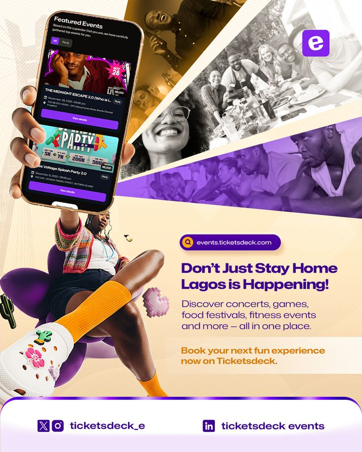

# Lagos Events App Flyer with Raised Phone

**Discipline:** print-social · **Design type:** Event flyer
**Tags:** events, purple, cream, collage, phone, photo-slices, flyer, portrait

## What it is
A cream and purple portrait flyer where a person lifts a phone showing event listings, above diagonal photo slices of happy crowds in purple and sepia tones, with a bold purple headline, orange sub-line and social footer.

## What it means
Diagonal photo slices and a lively pose give a party-like energy. Purple and orange feel vibrant and youthful.

## Techniques
- Diagonal slicing of photos into wedges
- Duotone purple treatment on one crowd photo
- Cut-out figure with a raised phone breaking the frame
- Bold two-colour headline with orange call to action
- White rounded footer panel with social handles

## Best for
- Event discovery and ticketing apps
- City-focused lifestyle campaigns
- Social promos with people and product

## Vocabulary
- **Photo wedge** — A photo cropped into a triangular or diagonal slice.
- **Frame break** — A subject extending beyond its container for depth.
- **Footer panel** — A rounded base strip holding contacts and handles.
