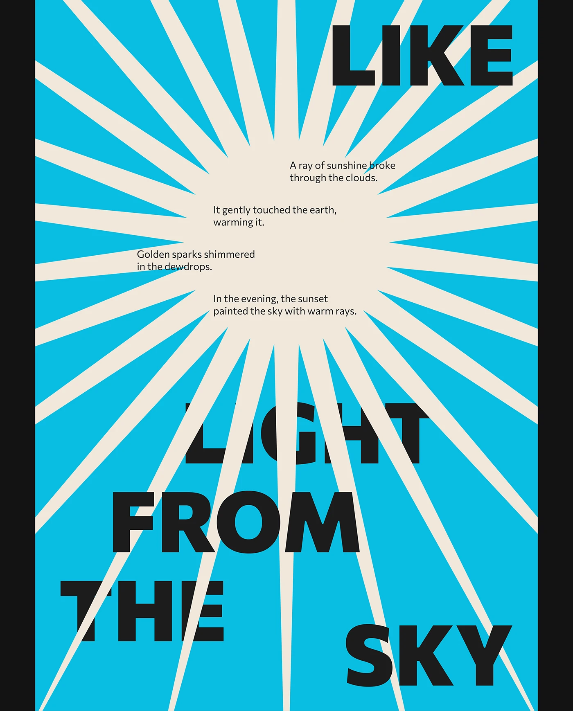

# Cyan poster with cream radiating rays and giant black 'LIKE LIGHT FROM THE SKY' scattered around the sun

**Discipline:** print-social ·  · **Design style:** Warm & Organic
**Tags:** poster, cyan, cream, black, rays, sunburst, scattered-type, concept

## What it is
A cyan poster with a large cream sun and thick radiating rays, four short lines of small black text stepping across the centre, and a giant heavy black 'LIKE LIGHT FROM THE SKY' scattered in single words that the rays cut through.

## What it means
Bright and optimistic; the rays slice the letters like light.

## Techniques
- Draw a sunburst from thick rays.
- Scatter giant words across the rays.
- Step small text lines across the sun.
- Use only cyan, cream and black.

## Best for
- Concept typographic posters
- Sunburst graphics
- Three-colour posters

## Vocabulary
- **Sunburst** — Rays radiating from a centre.
- **Scattered headline** — A phrase split across a poster.
- **Ray cut** — Rays passing over and cutting letters.
- **Stepped text** — Short text lines offset diagonally.
