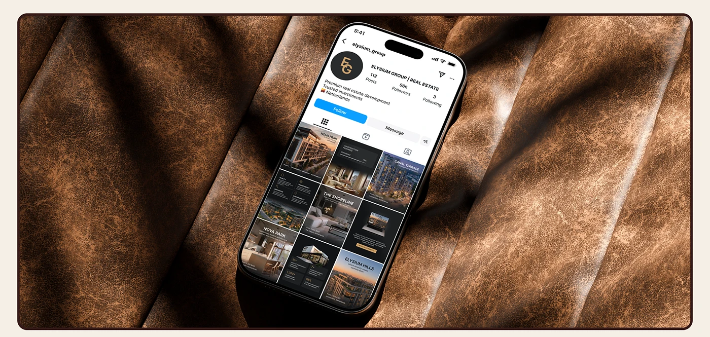

# Real-estate Instagram profile on a phone lying on folded tan leather in a brown frame

**Discipline:** print-social ·  · **Design style:** 3D & Surreal
**Tags:** instagram, feed-grid, leather, brown, gold, mockup, luxury, dark-feed

## What it is
A phone displaying a dark gold-monogram profile grid lies on creased, backlit tan leather, framed by a thin brown rounded border on cream.

## What it means
Rich and tactile; leather matches the gold-brown palette.

## Techniques
- Choose a material that matches the palette.
- Use raking light to show texture.
- Tilt the phone slightly.
- Frame with a brown keyline.

## Best for
- Luxury social presentations
- Feed mockups
- Real-estate brands

## Vocabulary
- **Material match** — A surface echoing brand colours.
- **Raking light** — Low-angle light showing texture.
- **Brown keyline** — A thin dark frame around an image.
- **Monogram avatar** — A round profile picture with initials.
