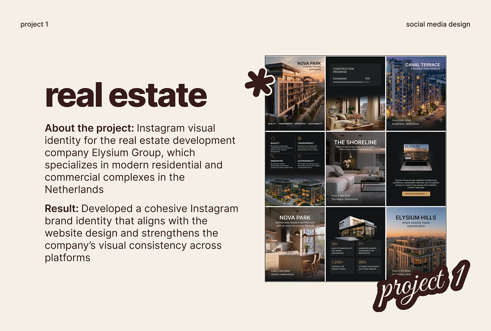

# Cream 'real estate' project slide showing a dark gold-accent Instagram grid with an asterisk sticker

**Discipline:** print-social ·  · **Design style:** Playful & Illustrated
**Tags:** case-study, social-media, real-estate, cream, chocolate, feed-grid, script-sticker, asterisk-sticker

## What it is
A cream slide with a huge chocolate 'real estate', About and Result paragraphs with bold lead-ins, a boxed 3x3 feed grid of dark residential posts with photos and gold text, a chunky outlined asterisk sticker and a script 'project 1' sticker.

## What it means
Warm and consistent; the dark grid stands out on cream.

## Techniques
- Reuse a slide template across projects.
- Show the whole grid boxed at the right.
- Overlap sticker shapes on its corners.
- Use bold lead-ins.

## Best for
- Social case-study slides
- Real-estate branding
- Portfolio decks

## Vocabulary
- **Slide template** — A reusable layout for each project.
- **Asterisk sticker** — A chunky outlined star-like shape.
- **Feed grid** — A 3x3 image of a profile.
- **Dark on cream** — A dark image on a light slide.
