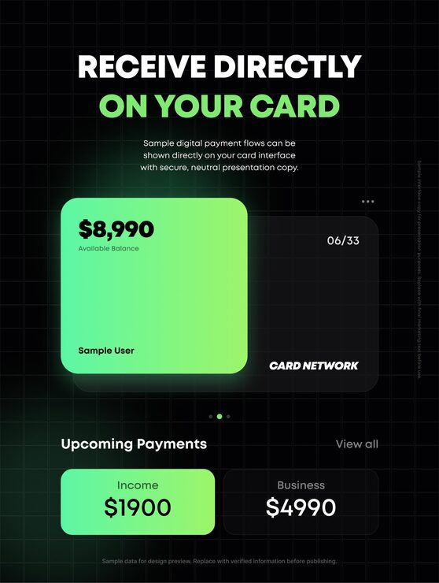

# 'Receive Directly on Your Card' promo with a glowing green gradient card over a dark card and payment tiles

**Discipline:** print-social · **Design type:** Product UI promo card · **Design style:** Dark & Neon
**Tags:** fintech, card, dark, neon-green, gradient, ui

## What it is
A portrait black post on a faint grid with a white and green uppercase headline, a glowing mint-to-lime gradient card ($8,990 Available Balance) overlapping a dark card (06/33, Card Network), carousel dots, an 'Upcoming Payments' header and two tiles: green Income $1900 and dark Business $4990.

## What it means
Fresh and modern; the glowing card feels like money arriving.

## Techniques
- Stack a bright card over a dark card for depth.
- Glow the hero card in its own colour.
- Echo the card gradient on one tile below.
- Use a faint grid backdrop for a tech feel.

## Best for
- Card and banking apps
- Fintech promos
- Payment feature posts

## Vocabulary
- **Card stack** — Overlapping card shapes showing multiple accounts.
- **Glow** — A soft light halo around an element.
