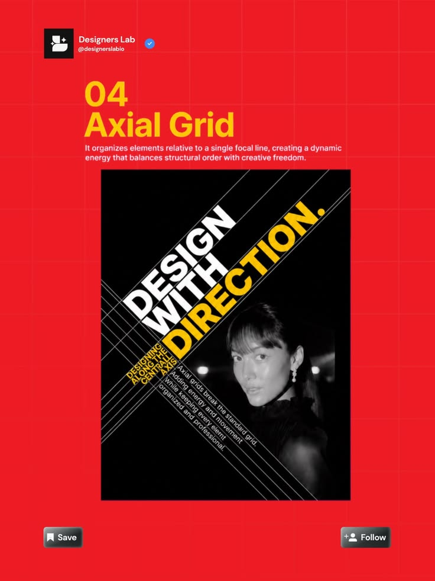

# Axial Grid Diagonal Type Lesson

**Discipline:** print-social ·  · **Design style:** Minimalist
**Tags:** grid, axial, diagonal-type, red, yellow, black-white, layout

## What it is
A red post over a light grid, with a yellow heading '04 Axial Grid', a short definition and a black poster sample where 'DESIGN WITH DIRECTION.' runs on a diagonal beside a monochrome portrait and crossing guide lines.

## What it means
The example poster demonstrates the technique with energy, and the red frame makes the lesson stand out in feeds.

## Techniques
- Rotate type along a central axis to create dynamism
- Guide lines drawn on the sample to reveal the structure
- Yellow and white type pair on black
- Monochrome photo integrated with diagonal text
- Saturated red frame with faint grid

## Best for
- Layout theory education
- Typographic poster inspiration
- Design account carousels

## Vocabulary
- **Axial grid** — A layout organised around a single central line or axis.
- **Diagonal type** — Text rotated to follow an angled axis.
- **Guide lines** — Visible construction lines revealing the layout.
