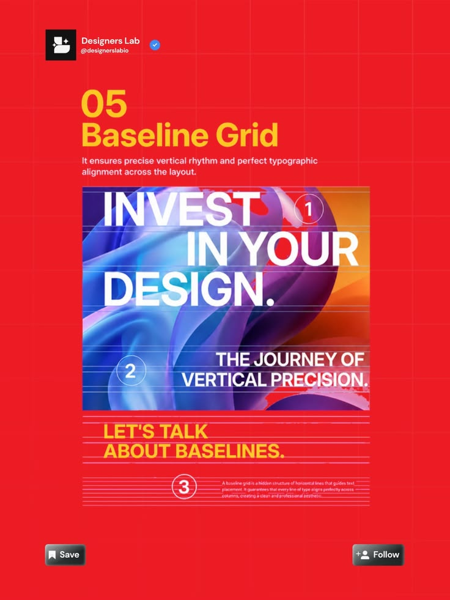

# Baseline Grid Lesson Post

**Discipline:** print-social · **Design type:** Social educational post
**Tags:** baseline-grid, red, yellow, poster-sample, lines, educational, numbers

## What it is
A red post with yellow heading '05 Baseline Grid', a definition and a sample poster ('Invest in your design.') with a fluid blue and orange background, overlaid with pink horizontal baselines and numbered circles.

## What it means
Visible baselines over real type show the concept directly, and the colourful sample pops on red.

## Techniques
- Horizontal baselines drawn over the sample
- Numbered circles annotating the points
- Fluid gradient image behind heavy white type
- Yellow headline blocks on red
- Series header and buttons

## Best for
- Typography education
- Grid and layout series
- Annotated example posts

## Vocabulary
- **Baseline grid** — Horizontal lines to which every line of text aligns.
- **Vertical rhythm** — Consistent spacing of text lines down the page.
- **Annotation circle** — A numbered marker pointing out part of an example.
