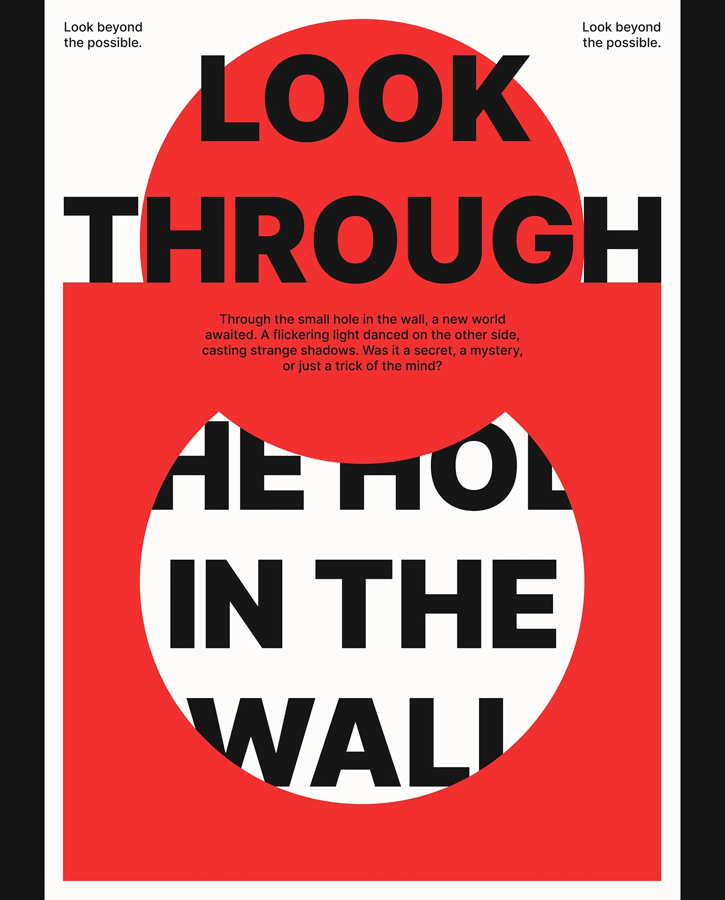

# Red poster where black words pass through a circular hole cut into a red block

**Discipline:** print-social ·  · **Design style:** Geometric & Bauhaus
**Tags:** poster, red, black, circle, cutout, giant-type, concept, swiss

## What it is
A white poster with a red circle behind giant black 'LOOK THROUGH' and a red rectangle below with a circular hole revealing white and the words 'THE HOLE IN THE WALL' cropped by the circle. Small text is centred and 'Look beyond the possible' repeats in the top corners.

## What it means
Clever and bold; the layout physically shows a hole in a wall.

## Techniques
- Cut a circular window in a solid block.
- Crop the text at the window edge.
- Overlap type on a red circle.
- Repeat a slogan in the top corners.

## Best for
- Concept typographic posters
- Swiss-style series
- Red and black graphics

## Vocabulary
- **Window cutout** — A shape cut into a block revealing what is behind.
- **Type crop** — Text cut by a shape edge.
- **Overlap layering** — Text over and under shapes.
- **Slogan repeat** — The same line at multiple corners.
