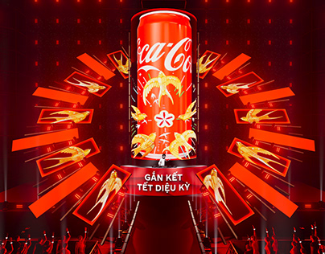

# Red stage render with a giant can, a fan of screens with golden swallows and red light bars over a runway

**Discipline:** print-social ·  · **Design style:** 3D & Surreal
**Tags:** event, stage, red, gold, can, led-screens, 3d-render, festive

## What it is
A saturated red stage where a giant cylinder can sits at the centre wrapped with gold swallows and a blossom, surrounded by a radial fan of red screens each showing a gold swallow and glowing red light bars, with a runway leading to a figure and a caption 'Gắn kết Tết diệu kỳ' and silhouetted crowds.

## What it means
Festive and grand; radial screens and one red world make a brand feel like a celebration.

## Techniques
- Arrange screens radially around a hero object.
- Flood the whole scene in one brand red.
- Repeat a gold motif on every screen.
- Add a runway leading to the centre.

## Best for
- Festive brand activations
- Stage and set design
- Single-colour immersive renders

## Vocabulary
- **Radial screen fan** — Screens arranged like rays around a centre.
- **Hero can** — A giant product cylinder as the centrepiece.
- **Gold motif** — A repeated gold illustration.
- **Colour flood** — An entire scene in one brand colour.
