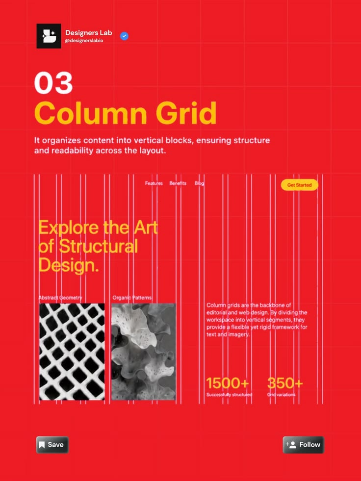

# Column Grid Lesson Post

**Discipline:** print-social · **Design type:** Social educational post
**Tags:** column-grid, red, yellow, website-sample, guides, educational, stats

## What it is
A red post with white and yellow heading '03 Column Grid', a definition and a website sample with pink vertical guide lines over a yellow headline, two black and white images and stat figures, with Save and Follow buttons.

## What it means
Vertical guide lines drawn over a real layout show what a column grid does, in a loud red frame.

## Techniques
- Vertical guide lines overlaid on a sample
- Yellow headline and stats on a red field
- Monochrome imagery to contrast the red
- Series header with account and follow
- Faint square grid across the whole post

## Best for
- Grid and layout lessons
- Design account series
- Annotated sample posts

## Vocabulary
- **Column grid** — A layout divided into vertical columns.
- **Guide overlay** — Lines drawn over a design to reveal its structure.
- **Sample layout** — A mini design shown to demonstrate a concept.
