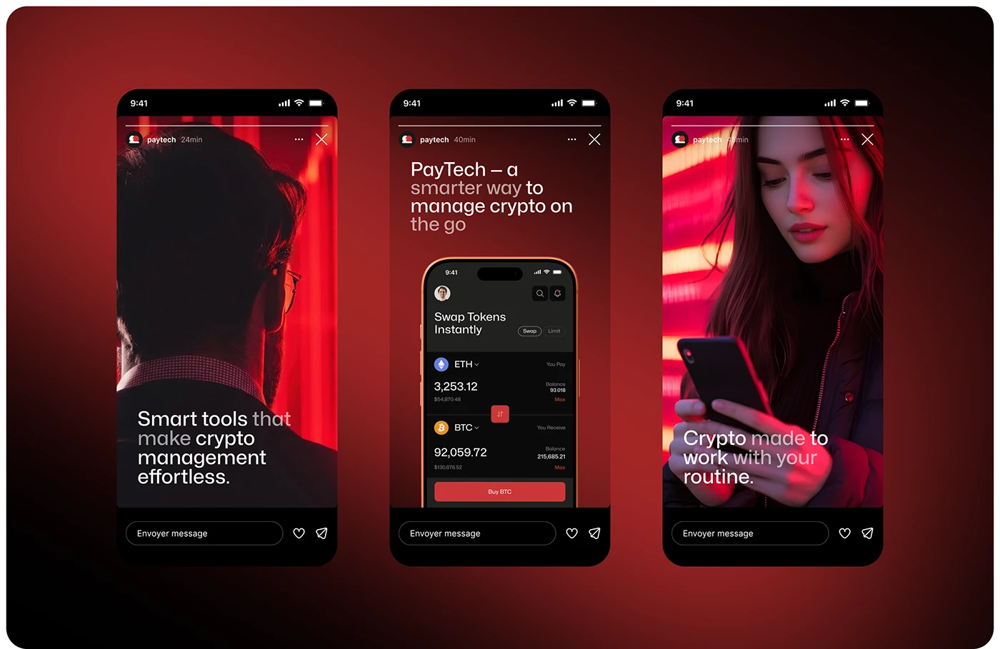

# Red Crypto Story Set

**Discipline:** print-social ·  · **Design style:** Dark & Neon
**Tags:** stories, crypto, red, photography, neon, swap, dark

## What it is
Three story frames on a dark red vignette: a man in silhouette lit by red, a centre story with a swap-token phone UI, and a woman looking at her phone in red neon, each with a short white headline and message bar.

## What it means
Red neon photography feels cinematic and urgent, and the product story in the middle links people to the interface.

## Techniques
- Photography lit in the brand red for cohesion
- Lightweight white sans headlines with dimmed words
- Middle story showing the product UI inside a device
- Story chrome with a reply bar for realism
- Consistent bottom-left headline placement

## Best for
- Crypto and fintech campaigns
- Story ad concepts
- Moody premium social sets

## Vocabulary
- **Brand-lit photography** — Photos lit or graded in the brand colour.
- **Dimmed words** — Selected words set at reduced opacity within a headline.
- **Story chrome** — The reply bar, progress lines and header of a story.
