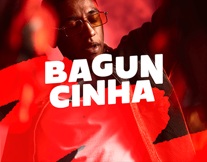

# Red duotone artist portrait with chunky white title

**Discipline:** print-social ·  · **Design style:** Photographic & Cinematic
**Tags:** music, cover, red, duotone, chunky-type, portrait, artist, bold

## What it is
A cover with a red-tinted photo of a man in tinted glasses under a bold red overlay with torn shapes, overlaid by a stacked heavy white title 'BAGUN CINHA'.

## What it means
Loud, rhythmic and youthful; red heat and thick type create a street-culture punch.

## Techniques
- Tint a photo with one saturated colour and overlay an expressive shape.
- Stack a title in a heavy rounded-blocky face across the centre.
- Let the face peek above the type for human contact.
- Add rough cut-out edges to the overlay.

## Best for
- Music artist and event covers
- Single or album art
- Festival and party promos

## Vocabulary
- **Duotone overlay** — A photo coloured with one strong hue.
- **Stacked title** — A name set on multiple lines as a block.
- **Torn shape** — A rough-edged cut-out overlaid on an image.
- **Chunky display face** — A very heavy, rounded typeface.
