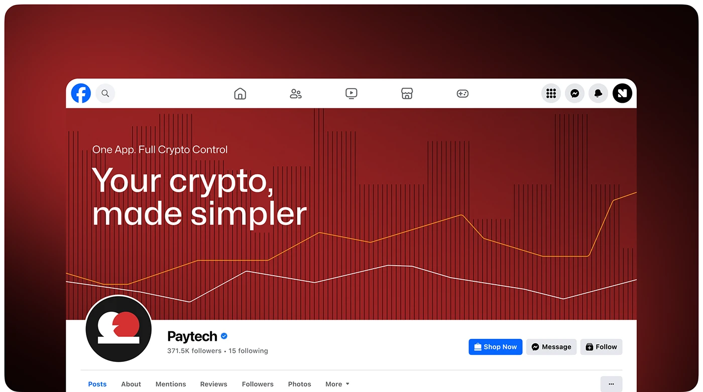

# Red Striped Chart Facebook Cover

**Discipline:** print-social · **Design type:** Feed mockup
**Tags:** facebook, cover, red, chart, stripes, crypto, profile

## What it is
A Facebook profile mockup on a dark red vignette with a cover of red vertical stripes and two crossing white and orange lines, the headline 'Your crypto, made simpler', and the brand avatar and buttons below.

## What it means
Turning the product's chart texture into a banner makes the brand instantly recognisable in the feed.

## Techniques
- Striped bars and line graphs as the banner art
- Large light headline with a small eyebrow
- Real platform chrome for context
- Circular dark avatar with the white and red mark
- One colour world across cover and surroundings

## Best for
- Social profile cover design
- Crypto and data brands
- Showing branding within platform UI

## Vocabulary
- **Cover art** — The wide banner image at the top of a profile.
- **Brand texture** — A pattern derived from the product that becomes a signature graphic.
- **Platform chrome** — The interface of the social site around the design.
