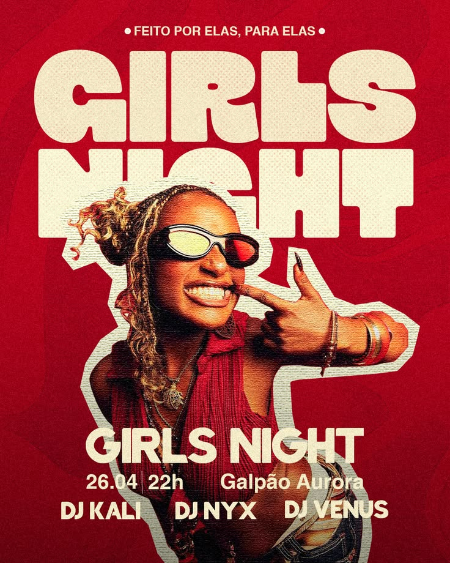

# Party flyer in red with cream bubble letters, a white-outlined dancer cutout and DJ lineup

**Discipline:** print-social · **Design type:** Event flyer
**Tags:** party, event, red, cream, bubble-type, cutout, dj-lineup, portuguese

## What it is
A textured red poster with a small tagline, giant cream chunky 'GIRLS NIGHT' with halftone shading, a cutout of a woman with sunglasses and braids outlined in thick cream overlapping the letters, then event name, date, venue and three DJ names in cream caps.

## What it means
Bold and joyful; retro bubble type and a cream outline feel like a party sticker.

## Techniques
- Overlap the cutout on giant letters.
- Outline the cutout in thick cream.
- Use one red and one cream.
- List details in a compact tri-row.

## Best for
- Party and club flyers
- Two-colour event posters
- Cutout-over-type layouts

## Vocabulary
- **Bubble type** — Fat rounded letters.
- **Cutout overlap** — A cutout figure breaking over text.
- **Halftone shade** — Dot shading inside letters.
- **Lineup row** — DJ names in a single line.
