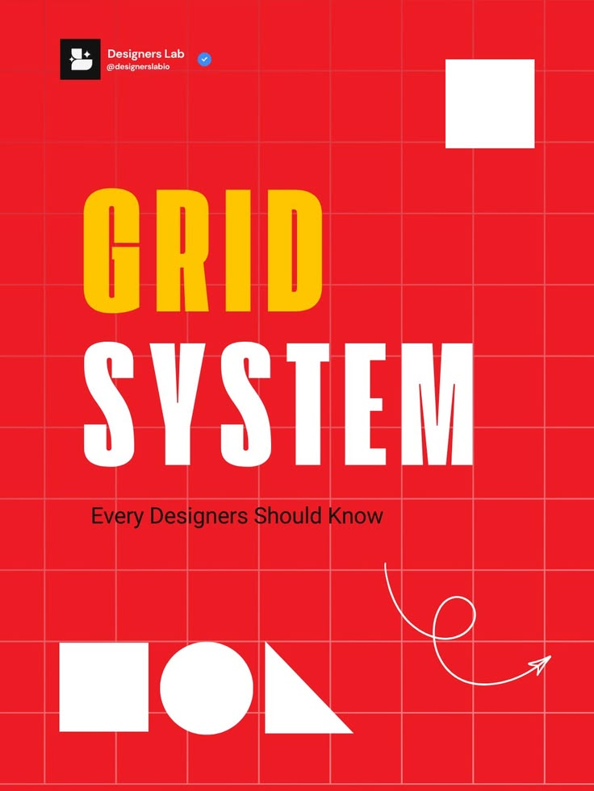

# Red Grid System Cover Post

**Discipline:** print-social · **Design type:** Social educational post
**Tags:** red, grid, condensed, yellow, geometric-shapes, educational, portrait

## What it is
A saturated red portrait post overlaid with a visible pale grid, a huge condensed 'GRID' in yellow over 'SYSTEM' in white, a subtitle, geometric shapes and a looping arrow.

## What it means
The visible grid demonstrates the topic itself. Red, yellow and white are loud and confident.

## Techniques
- Draw the grid you are talking about
- Condensed heavy caps in two colors as a stacked headline
- Basic shapes (square, circle, triangle) as a visual glossary
- Hand-drawn looping arrow for movement
- Author handle badge top-left

## Best for
- Design education posts
- Bold cover slides for carousels
- Content that needs to grab a scroll

## Vocabulary
- **Visible grid** — Layout gridlines shown as part of the design.
- **Condensed type** — Narrow letterforms that allow very large headlines.
- **Primitive shapes** — Circle, square and triangle used as basic building blocks.
