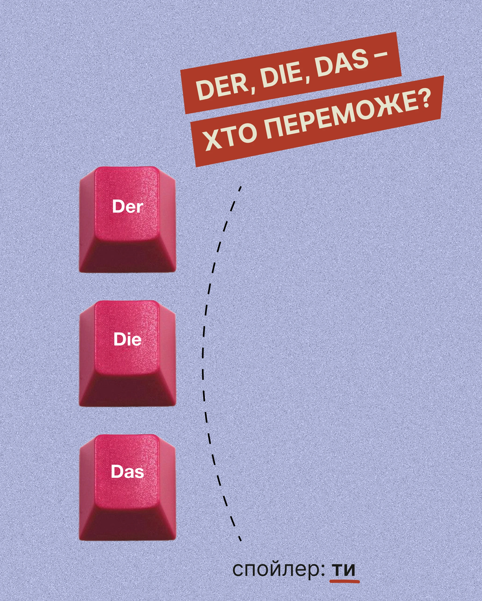

# Periwinkle grain post with three red keyboard keycaps and tilted red banners: who wins?

**Discipline:** print-social ·  · **Design style:** Retro & Pixel
**Tags:** language, quiz, periwinkle, red, keycaps, dashed-line, grain, cyrillic

## What it is
A grainy periwinkle post with two tilted red banners with cream caps, three 3D red keycaps labelled Der, Die and Das stacked at the left, a dashed curved divider and a small line 'spoiler: ти' with a red underline.

## What it means
Playful and clean; keycaps make grammar genders feel like game buttons.

## Techniques
- Use physical keycaps as answer buttons.
- Tilt banners for the question.
- Draw a dashed line separating options from reveal.
- Reveal the answer in tiny text.

## Best for
- Language quizzes
- Interactive-feeling posts
- Retro-tech object posts

## Vocabulary
- **Keycap object** — A keyboard key used as a graphic.
- **Answer buttons** — Options shown as pressable items.
- **Dashed divider** — A dotted line separating regions.
- **Spoiler line** — A small reveal at the bottom.
