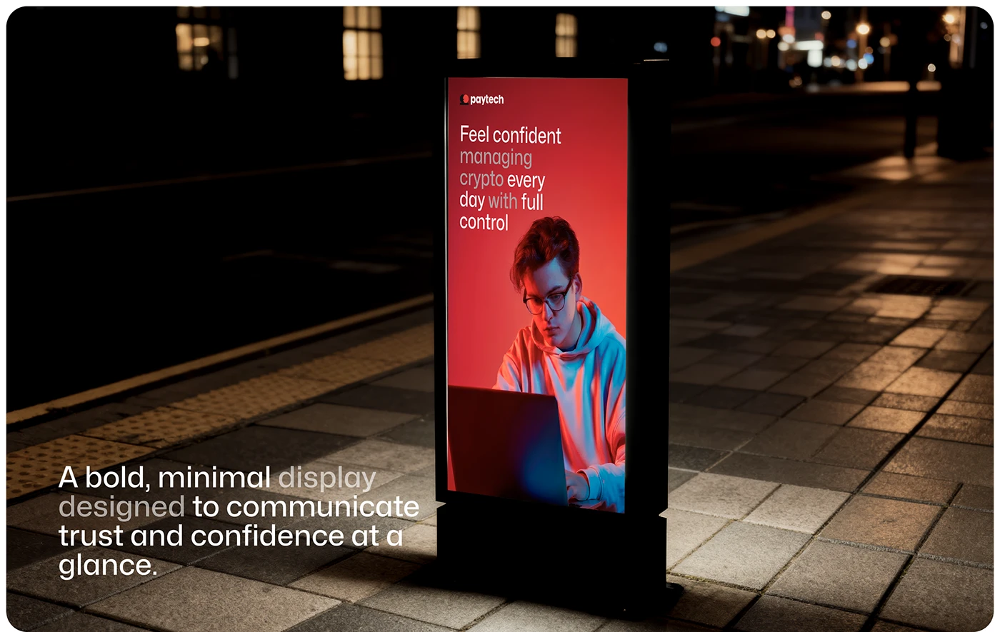

# Red Light Box Ad at Night

**Discipline:** print-social ·  · **Design style:** Dark & Neon
**Tags:** billboard, light-box, red, night, street, portrait, fintech

## What it is
A night street scene with a freestanding light box ad glowing red, showing a logo and a headline about feeling confident managing crypto with a person at a laptop lit in red and blue, and a caption at lower left about a bold minimal display.

## What it means
A glowing red panel in a dark street draws the eye, and the ad's simple headline matches the calm brand promise.

## Techniques
- Backlit poster in a dark street
- Red and blue duotone portrait
- Dimmed words within the headline
- Caption placed in the foreground on the pavement
- Cinematic wet-pavement reflections

## Best for
- Out-of-home ad mockups
- Fintech and crypto campaigns
- Night scene presentations

## Vocabulary
- **Light box** — An illuminated advertising display.
- **Night scene mockup** — An ad shown in a realistic nighttime setting.
- **Duotone portrait** — A photo lit with two colours.
