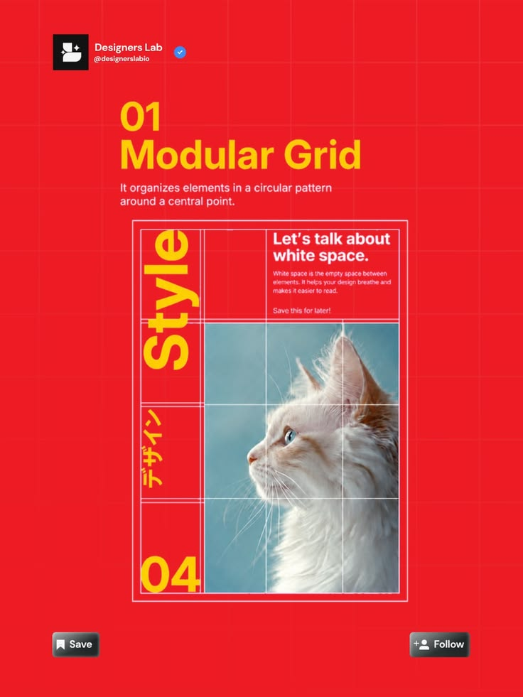

# Modular Grid Lesson with Cat Poster

**Discipline:** print-social ·  · **Design style:** Geometric & Bauhaus
**Tags:** modular-grid, red, yellow, cat, poster-sample, japanese, educational

## What it is
A red post with yellow heading '01 Modular Grid', a definition and a framed poster sample with a cat photo cut by white grid lines, vertical yellow 'Style' type, Japanese katakana, a white text block about white space and number 04.

## What it means
A poster sample built on a visible modular grid shows the principle, and yellow on red is loud.

## Techniques
- Visible white grid lines over a photo
- Vertical rotated display word
- Mixed scripts (Latin and Japanese) as a texture
- Yellow on red contrast
- Series header with account and follow buttons

## Best for
- Layout theory lessons
- Design account series
- Poster-sample explanations

## Vocabulary
- **Modular grid** — A grid of rows and columns making equal cells.
- **Rotated display type** — Large text turned 90 degrees.
- **Grid overlay** — Lines drawn over an image to reveal structure.
