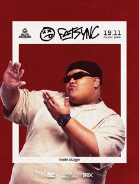

# Festival poster with a white frame around a red-toned performer

**Discipline:** print-social ·  · **Design style:** Photographic & Cinematic
**Tags:** music, festival, red, white-frame, portrait, poster, playful, dj

## What it is
A portrait poster with a red-tinted photo of a smiling man in sunglasses. A thick white rectangle frames him, with the event logo and date across the top and 'main stage' on the bottom edge. Sponsor logos sit at the base.

## What it means
Bold and simple; the frame turns the performer into a picture or ticket.

## Techniques
- Frame a subject with a thick white border, letting their hands break the frame.
- Tint the photo a single colour and keep the frame neutral.
- Place event metadata inside the frame edges.
- Let a small logo cluster close the poster.

## Best for
- Music and festival posters
- Lineup announcements
- Portrait-led event promotion

## Vocabulary
- **Breaking the frame** — A subject extending beyond a border.
- **Photo border** — A plain frame around a picture.
- **Lineup card** — A poster or card featuring one performer.
- **Monochrome tint** — A single colour applied to a photo.
