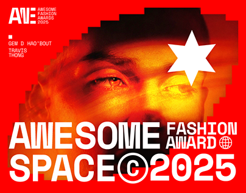

# Fashion award poster in red with a pixel-stepped eye portrait, white star and giant white type

**Discipline:** print-social ·  · **Design style:** Retro & Pixel
**Tags:** award, fashion, red, pixelated, white-type, star, copyright-symbol, poster

## What it is
A red poster with a face cropped to the eyes and cut in stepped pixel edges with a red-orange tint, a white six-point star, a small logo and names at the top left and giant white heavy 'AWESOME SPACE © 2025' with 'FASHION AWARD' in a smaller block and a globe icon.

## What it means
Loud and contemporary; stepped pixel edges and giant type feel digital and fashion.

## Techniques
- Crop a portrait to the eyes with stepped edges.
- Tint in red-orange.
- Set giant white type across the bottom.
- Add a white star as a graphic.

## Best for
- Fashion awards and events
- Red duotone posters
- Pixel-edge photography

## Vocabulary
- **Pixel-stepped crop** — A photo mask with stair-stepped edges.
- **Red duotone** — A photo in red tones.
- **Bottom-heavy type** — Giant text along the bottom.
- **Star glyph** — A six-point star used as a graphic.
