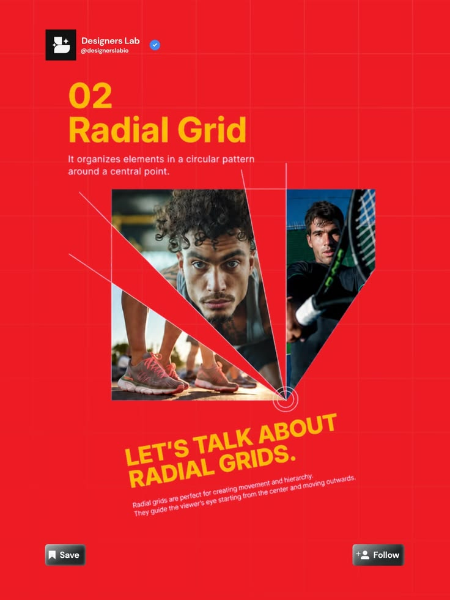

# Radial Grid Lesson Post

**Discipline:** print-social ·  · **Design style:** Gradient & Aurora
**Tags:** radial-grid, red, yellow, photo-fan, educational, layout, grid

## What it is
A red post over a light grid with yellow heading '02 Radial Grid', a definition, a sample where two photos are cut into wedges fanning from a central point with guide lines, a yellow angled headline and Save and Follow buttons.

## What it means
The sample demonstrates the technique and the red and yellow are loud enough to stop a scroll.

## Techniques
- Photos cropped into wedges that radiate from one point
- Thin guide lines extending from the centre
- Angled yellow headline echoing the radial idea
- Red field with faint grid
- Series header with account and follow buttons

## Best for
- Layout theory education
- Design account series
- Radial and fan compositions

## Vocabulary
- **Radial grid** — A layout arranged in a circular pattern around a centre.
- **Wedge crop** — An image cut into a triangular slice.
- **Focal point** — The centre from which elements radiate.
