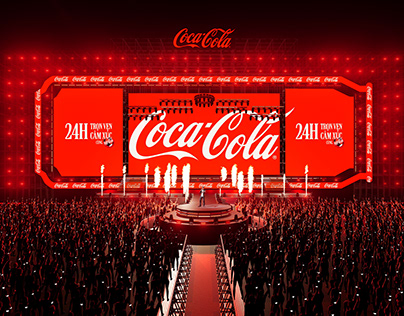

# Red stadium concert stage with giant LED screens and a lit crowd

**Discipline:** print-social · **Design type:** Event key visual
**Tags:** event, stage, red, led-screens, crowd, brand-activation, key-visual, render

## What it is
A rendered stage design in saturated red with a huge central script logo on an LED wall, two side screens with '24H' text, a lit catwalk and runway, and a dense crowd with phone lights in the foreground.

## What it means
Loud and immersive; one brand colour floods the space so the brand becomes the venue.

## Techniques
- Flood an entire scene with one brand colour.
- Use a giant logo as the stage backdrop.
- Line screens and lights to draw a central perspective.
- Show the crowd as small lit dots.

## Best for
- Brand activations and concerts
- Stage and event design
- Experiential concepts

## Vocabulary
- **Colour flood** — Making an entire scene one brand colour.
- **LED wall** — A large screen made from LED panels.
- **Central perspective** — A composition converging on one point.
- **Key visual** — The main image representing a campaign.
