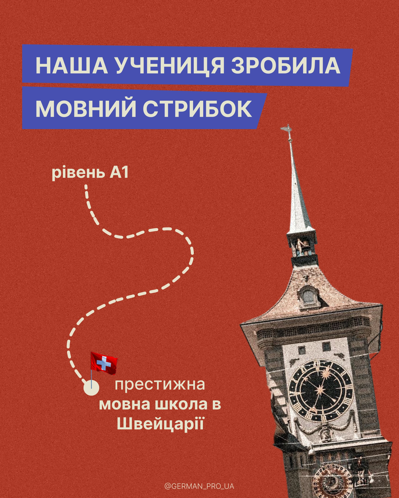

# Brick-red grain post with blue title strips, a dashed route to a flag and a clock-tower cutout

**Discipline:** print-social ·  · **Design style:** Retro & Pixel
**Tags:** success-story, red, grain, blue-banners, dashed-path, tower, flag, cyrillic

## What it is
A grainy brick-red post with two slanted blue banners with cream caps, a dashed cream wiggling line from a level label down to a dot with a Swiss flag, text about a prestigious school and a big cutout photo of a clock tower at the right.

## What it means
Proud and direct; the winding path shows a learner's journey.

## Techniques
- Show progress as a dashed winding path.
- Use slanted paper-like banners.
- Place a landmark cutout at the edge.
- Use one red with blue and cream.

## Best for
- Student success stories
- Journey posts
- Landmark collages

## Vocabulary
- **Journey path** — A dashed line from start to end.
- **Slanted banner** — A title strip with angled edges.
- **Landmark cutout** — A famous building cut from a photo.
- **Flag pin** — A tiny flag marking a destination.
