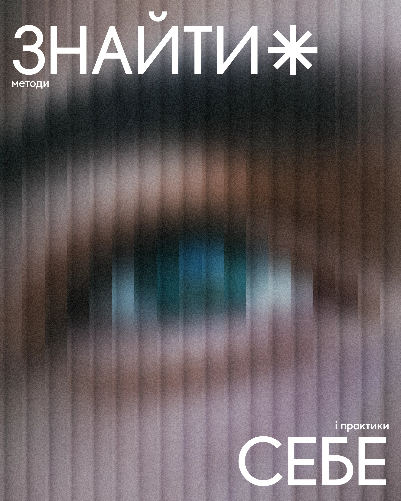

# Reeded-glass blurred close-up of an eye with thin white caps and an asterisk

**Discipline:** print-social ·  · **Design style:** Glassmorphism
**Tags:** wellness, blur, reeded-glass, eye, white-caps, asterisk, grain, cyrillic

## What it is
A portrait photo of an eye seen through vertical ribbed glass and heavy grain in violet, brown and teal, with a giant thin white 'ЗНАЙТИ' plus an asterisk at the top left, small 'методи' below and 'і практики СЕБЕ' at the lower right.

## What it means
Introspective and dreamy; blur suggests self-searching.

## Techniques
- Distort a photo with reeded-glass streaks.
- Add heavy grain.
- Set thin caps at opposite corners.
- Use an asterisk as punctuation.

## Best for
- Psychology and self-discovery posts
- Abstract photo covers
- Thin-type editorial layouts

## Vocabulary
- **Reeded glass effect** — Vertical ribbed distortion of an image.
- **Corner headline** — Words placed in opposite corners.
- **Grain** — Visible film-like noise.
- **Asterisk mark** — A star-like glyph as decoration.
