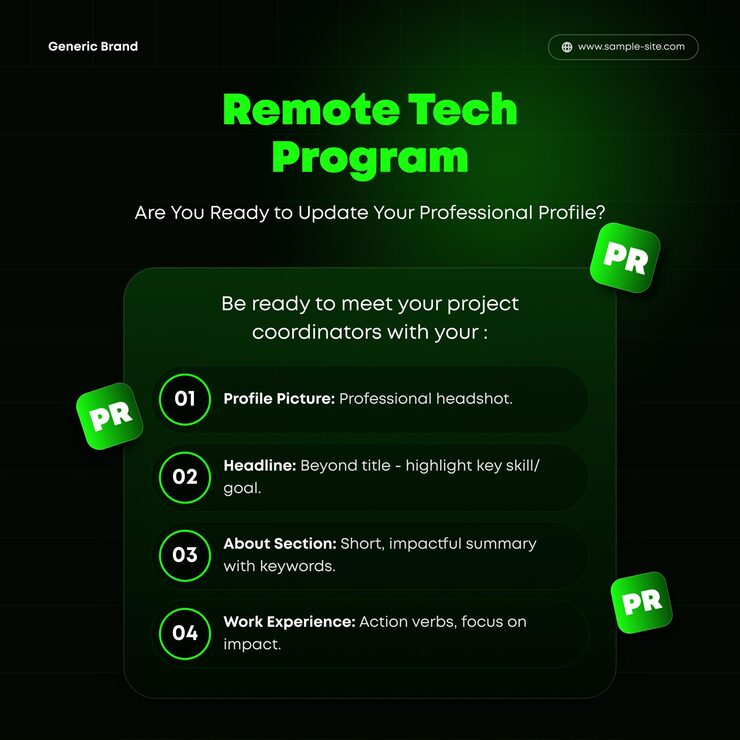

# 'Remote Tech Program' post with numbered green-ringed rows and floating 'PR' app tiles

**Discipline:** print-social · **Design type:** Social educational post · **Design style:** Dark & Neon
**Tags:** career, tech-program, dark, neon-green, checklist, profile

## What it is
A square black-green post with a neon green 'Remote Tech Program' title, a white question subhead, and a glass panel listing four numbered rows (01 Profile Picture, 02 Headline, 03 About Section, 04 Work Experience) with green-ringed numbers, plus three tilted glossy green 'PR' app-icon tiles floating around.

## What it means
Motivating and structured; the checklist makes profile advice actionable and techy.

## Techniques
- Number tips in outlined neon rings.
- Float tilted app-icon tiles around a panel.
- Bold the label and keep the tip short.
- Glow a green gradient from the top.

## Best for
- Career programmes
- Tech bootcamps
- LinkedIn tips

## Vocabulary
- **Numbered row** — A list item led by a number badge.
- **App-icon tile** — A rounded square like a phone icon.
