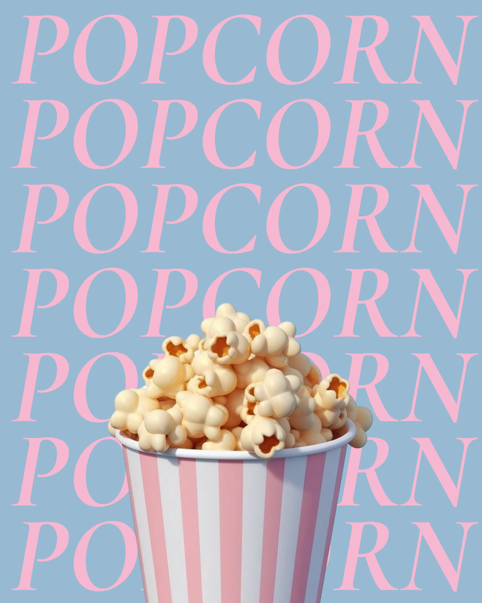

# Six rows of pink italic serif POPCORN on blue behind a striped popcorn bucket

**Discipline:** print-social ·  · **Design style:** Editorial
**Tags:** typography, repetition, pink, blue, serif-italic, 3d-cutout, food, pastel

## What it is
A dusty blue portrait with the word POPCORN repeated six times in large pink italic serif capitals, filling the frame. A 3D-style striped pink-and-white bucket of popcorn rises from the bottom, overlapping the lower rows.

## What it means
Sweet, nostalgic and instantly readable; repetition turns a word into a pattern.

## Techniques
- Repeat one word to fill the frame as a pattern.
- Pair pink and blue pastels.
- Let the product cut-out overlap the text rows.
- Use elegant italic serif for a soft, cinematic tone.

## Best for
- Food and snack promotions
- Minimal typographic posts
- Product-plus-word posters

## Vocabulary
- **Word repetition** — Repeating a word to create a texture.
- **Product overlap** — An object cut over the text layer.
- **Pastel duo** — Two soft complementary colours.
- **Italic caps** — Uppercase letters set in italic.
