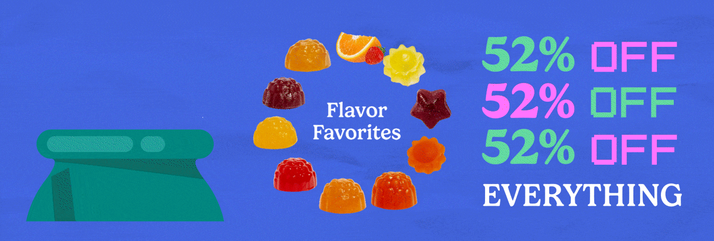

# Cobalt sale banner with ring of gummies and repeating pixel-type discount

**Discipline:** print-social · **Design type:** Animated banner
**Tags:** banner, sale, cobalt, gummies, ring, pixel-type, serif, animated

## What it is
A wide cobalt banner. At left, a teal tub shape; centre, a ring of glossy gummies and a slice of orange around 'Flavor Favorites' in serif; at right, three lines '52% OFF' in alternating green and pink pixel numerals with 'EVERYTHING' in white serif below.

## What it means
Bright, rhythmic and impossible to miss; repeating the offer makes it feel like a chant.

## Techniques
- Repeat the key offer three times with alternating colours.
- Combine pixel-style figures with classic serif.
- Arrange the product in a ring around a label.
- Animate items rotating for a lively loop.

## Best for
- Sales banners and email headers
- Motion ads
- Supplements and snack brands

## Vocabulary
- **Repetition headline** — Saying the same phrase several times for emphasis.
- **Pixel numerals** — Numbers drawn as a blocky pixel font.
- **Product ring** — Items arranged in a circle around text.
- **Serif-pixel pairing** — Mixing classic and digital type styles.
