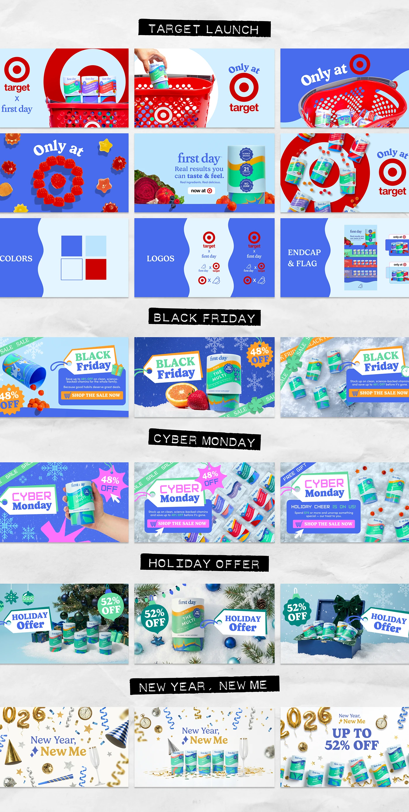

# Retail launch and seasonal banner set: Target, Black Friday, Cyber Monday, Holiday, New Year

**Discipline:** print-social ·  · **Design style:** Dark & Neon
**Tags:** banners, retail, royal-blue, red, seasonal, tag-labels, sale-badges, system

## What it is
A long sheet with black tape-style headers dividing five campaign sections, each with three wide banners in royal blue and pale blue: a retailer launch with red basket and bullseye, colour/logo/endcap pages, Black Friday and Cyber Monday with hang-tag titles and 48% badges, Holiday with snow and ornaments, and New Year with gold balloons.

## What it means
Organised and festive; one blue-and-red system flexes across every sale moment.

## Techniques
- Head each section with a black label strip.
- Use hang-tag shapes for campaign titles.
- Repeat round percentage badges.
- Swap props by season while keeping layout.

## Best for
- Retail promotional banner families
- Seasonal sale systems
- E-commerce marketing kits

## Vocabulary
- **Hang-tag title** — A title in a shape like a price tag.
- **Section label strip** — A black tape-like header naming a group.
- **Percentage badge** — A round sticker with a discount.
- **Banner system** — A set of wide banners sharing structure.
