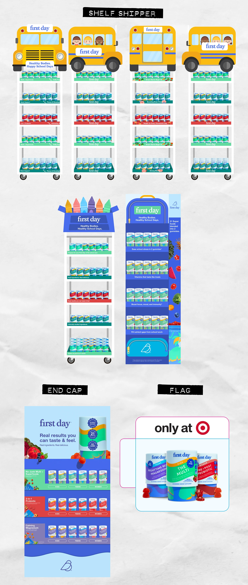

# Back-to-school shelf shippers, end cap and flag display concepts

**Discipline:** print-social · **Design type:** Retail display graphics
**Tags:** retail, point-of-purchase, packaging, school-bus, end-cap, blue, illustration, display-design

## What it is
A presentation of in-store display concepts for a gummy vitamin brand. Six shipper racks are topped with illustrated yellow school buses and a crayon box; a backpack-shaped display shows product; an end cap has bright blue shelves; and an 'only at' flag sits on white. Labels 'SHELF SHIPPER', 'END CAP' and 'FLAG' are in black tape-like strips.

## What it means
Playful and seasonal, making a supplement feel like a school-day companion; strong colour blocks make it visible across a store.

## Techniques
- Use a seasonal icon (school bus, crayons) as a topper to turn shelving into a character.
- Colour-code shelf bands by product to organise a wall.
- Label sections with black tape-like strips against a crumpled paper backdrop.
- Make a tall display echo a familiar shape (backpack) with zippers and pockets.

## Best for
- Retail merchandising and point-of-purchase
- Seasonal campaigns
- Packaging and display concept decks

## Vocabulary
- **Shelf shipper** — A display unit that ships pre-loaded with product.
- **End cap** — A display at the end of a store aisle.
- **Topper** — A themed graphic placed above a display.
- **Shelf band** — A coloured strip identifying a row of products.
