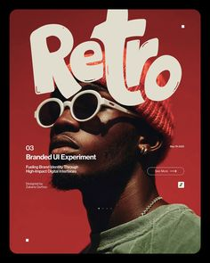

# Retro poster with huge cream bubble type over a red-toned portrait

**Discipline:** print-social ·  · **Design style:** Retro & Pixel
**Tags:** poster, retro, red, cream, bubble-type, portrait, round-glasses, editorial

## What it is
A red-framed portrait poster with a man in a red beanie and white round sunglasses. The word 'Retro' in massive cream rounded letters sits above his head, overlapped by the hat. Small caption text and a pill button sit at the lower area.

## What it means
Bold, nostalgic and fashionable; type interlocking with the subject makes it feel like a magazine cover.

## Techniques
- Let the subject overlap the giant headline so it appears behind the hat.
- Tint the whole photo red to match a brand palette.
- Use a fat rounded 70s-style type in cream.
- Add small caption and a pill button as a subtle UI layer.

## Best for
- Fashion and brand campaigns
- Retro-styled posters
- UI concept promo posters

## Vocabulary
- **Type behind subject** — Placing letters behind a cut-out person for depth.
- **Bubble letters** — Fat, rounded letterforms.
- **Red duotone** — A photo treated to appear in shades of red.
- **Pill button** — A rounded call-to-action.
