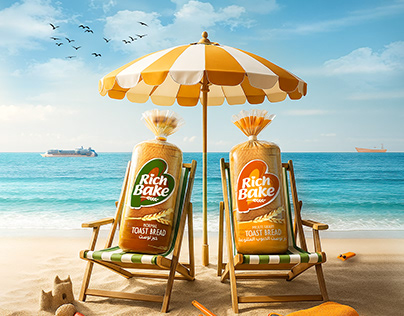

# Rich Bake toast bread loaves lounging on beach chairs under an orange parasol

**Discipline:** print-social · **Design type:** Brand campaign visual · **Design style:** Photographic & Cinematic
**Tags:** food, bread, summer, beach, product-manipulation, campaign

## What it is
A bright composite of two bagged Rich Bake toast loaves sitting in striped deckchairs under an orange-and-white parasol on a sandy beach, with a sandcastle, seagulls, ships on the horizon and a blue sky.

## What it means
Cheerful and witty; personifying bread on holiday makes an everyday staple feel summery.

## Techniques
- Seat packaged products like holidaymakers.
- Match parasol colours to the pack.
- Fill the scene with small beach details for charm.

## Best for
- FMCG summer campaigns
- Food brand social
- Playful product ads

## Vocabulary
- **Composite** — An image assembled from several photos.
- **FMCG** — Fast-moving consumer goods, everyday supermarket products.
