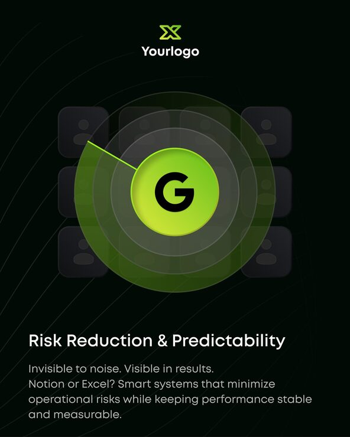

# 'Risk Reduction & Predictability' post with a lime radar sweep over a grid of avatar tiles

**Discipline:** print-social · **Design type:** Social educational post · **Design style:** Dark & Neon
**Tags:** saas, risk, dark, lime, radar, tech

## What it is
A portrait near-black post with a lime X logo, a lime circle with a black 'G' at the centre of concentric radar rings with a green sweep beam, over a faded 3x3 grid of avatar placeholder tiles, and a white title with grey body copy ('Invisible to noise. Visible in results.').

## What it means
Precise and watchful; the radar metaphor sells monitoring and control.

## Techniques
- Use a radar sweep as a monitoring metaphor.
- Fade a grid of tiles behind the focal ring.
- Glow one neon colour on black.
- Keep copy short and at the bottom.

## Best for
- SaaS security or ops tools
- Risk management products
- Tech explainers

## Vocabulary
- **Radar sweep** — A rotating beam wedge over concentric circles.
- **Focal ring** — The central circle drawing attention.
