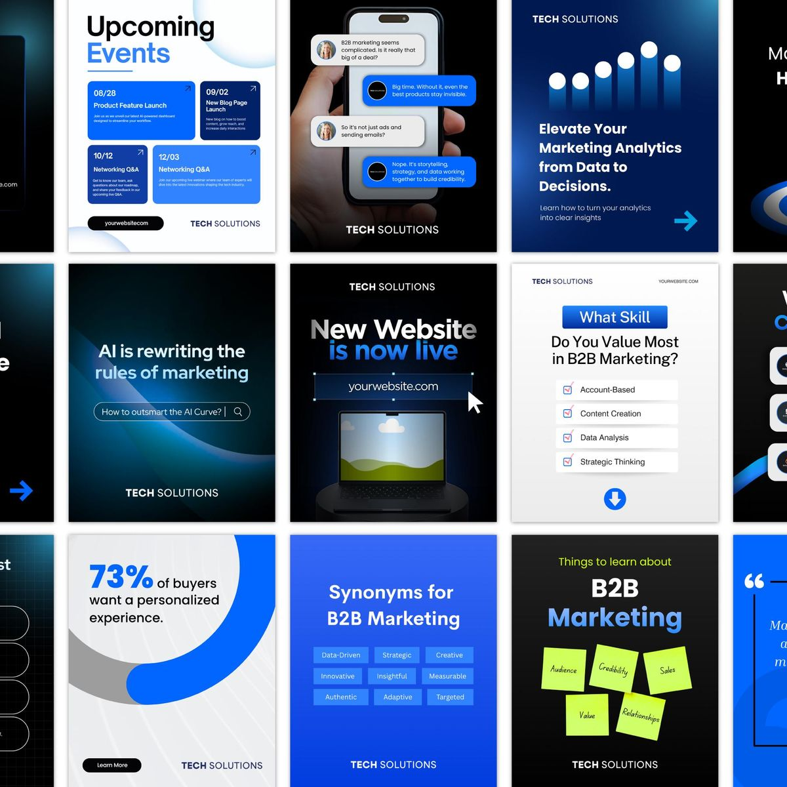

# Mosaic of royal-blue, black and white B2B posts with chat bubbles, charts and sticky notes

**Discipline:** print-social · **Design type:** Social template pack
**Tags:** b2b, templates, royal-blue, black, chat-bubbles, sticky-notes, charts, tech

## What it is
A cropped grid of portrait posts for a marketing firm: upcoming events cards, a phone with blue and grey chat bubbles, glowing bar chart, a search-bar prompt, a laptop reveal, checklist quiz, a 73% ring stat, a chip list and lime sticky notes on black.

## What it means
Confident and tidy; blue glow on black feels techy and clear.

## Techniques
- Vary formats (chat, chart, list, stat) in one blue system.
- Use lime sticky notes as the one off-palette accent.
- Apply glowing gradients on black.
- Keep the brand name at the bottom.

## Best for
- B2B marketing carousels
- Tech consultancies
- Template mosaics

## Vocabulary
- **Chat-bubble post** — A post showing a message conversation.
- **Ring stat** — A ring chart with a large percentage.
- **Sticky-note motif** — Colourful notes as graphic elements.
- **Glow gradient** — A luminous blue blend on black.
