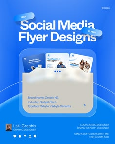

# Blue gradient designer promo with tilted pill titles and a frosted folder holding post thumbnails

**Discipline:** print-social · **Design type:** Social promo post
**Tags:** designer, promo, royal-blue, glass-folder, pills, thumbnails, brand-info, gradient

## What it is
A blue radial-gradient 4:5 post with 'Social Media Flyer Designs' on tilted glass pills, a frosted translucent folder from which three post thumbnails peek, a cream info block with brand name, industry and typeface, and a designer avatar with contact line at the bottom.

## What it means
Modern and organised; the glass folder makes a portfolio feel like an object.

## Techniques
- Tilt glass pills as a title.
- Show work as thumbnails in a frosted folder.
- List project facts in a small info block.
- Add a contact footer.

## Best for
- Designer portfolio promos
- Service and case-study posts
- Glassmorphism social posts

## Vocabulary
- **Glass folder** — A translucent folder graphic.
- **Tilted pill** — A rotated capsule label.
- **Info block** — A short list of project facts.
- **Thumbnail peek** — Small images showing above an edge.
