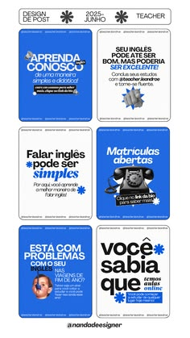

# Six royal-blue and white English-teacher posts with cutouts, stickers and bold caps

**Discipline:** print-social · **Design type:** Social template pack
**Tags:** education, teacher, royal-blue, white, portuguese, stickers, cutout, phone-call

## What it is
A board of six 4:5 posts alternating royal blue and white, with heavy sans headlines, a woman cut-out, a retro telephone, blue star stickers and small tag pills, with a header row of labels and a handle at the bottom.

## What it means
Bright and direct; bold blue-and-white type reads instantly in a feed.

## Techniques
- Alternate blue and white backgrounds.
- Use huge bold headlines with one accent word.
- Add small starburst stickers.
- Include one quirky object (retro phone).

## Best for
- Language teachers and tutors
- Education carousels
- Simple two-colour feed systems

## Vocabulary
- **Two-colour feed** — A feed limited to two brand colours.
- **Starburst sticker** — A small spiky decorative shape.
- **Quirky object** — An unexpected prop adding personality.
- **Header row** — Small labels along the top of a board.
