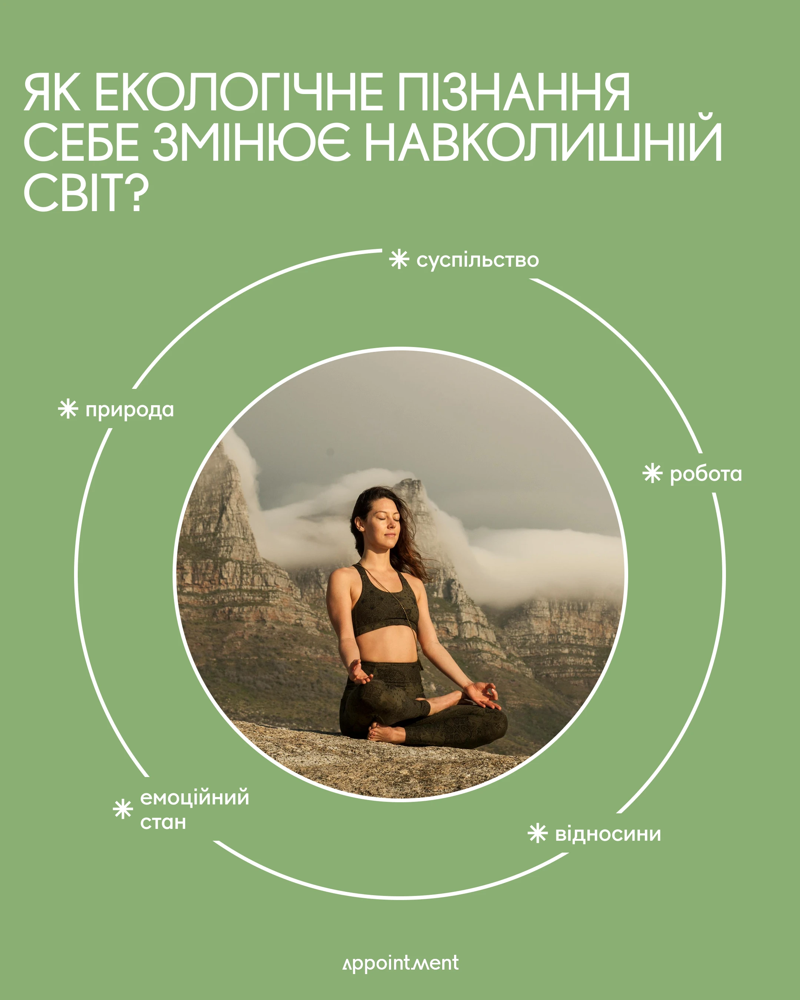

# Sage green post with photo in a circle ringed by broken orbit and asterisk labels

**Discipline:** print-social ·  · **Design style:** Warm & Organic
**Tags:** wellness, sage-green, circle, orbit, asterisk, uppercase-headline, cyrillic, infographic

## What it is
A 4:5 post on sage green with a giant white uppercase headline. A circular photo of a woman meditating in mountains sits in the middle, surrounded by a thin white ring broken by five asterisk-marked words. A small logo sits at the base.

## What it means
Serene and thoughtful; the ring suggests connected areas of life around a centre.

## Techniques
- Break a thin outer ring at each label so words sit on the orbit.
- Crop the hero photo to a perfect circle at the centre.
- Use an asterisk as a small bullet glyph.
- Keep the palette to one green plus white for calm.

## Best for
- Wellness and coaching content
- Concept diagrams with a central idea
- Text-led posts with one image

## Vocabulary
- **Orbit ring** — A thin circle around a subject, with labels on it.
- **Circle crop** — A photo masked to a circle.
- **Asterisk bullet** — A star-like mark used as a list marker.
- **Radial diagram** — A layout where topics surround a centre.
