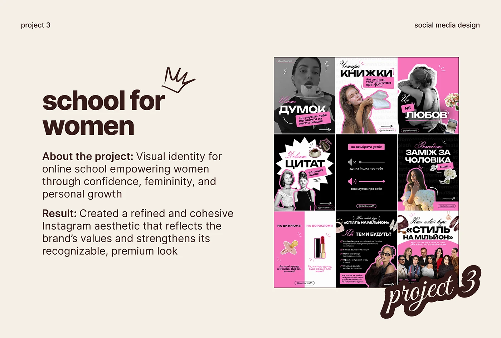

# Cream 'school for women' slide with a doodle crown and a pink, black and white feed grid

**Discipline:** print-social · **Design type:** Presentation slides
**Tags:** case-study, social-media, cream, pink, black, feed-grid, crown-doodle, script-sticker

## What it is
A cream slide with tiny labels, a heavy chocolate 'school for women' topped by a hand-drawn crown, About and Result paragraphs and a boxed 3x3 grid of pink, black and white posts with greyscale cutouts, script words and pink labels, plus a script 'project 3' sticker.

## What it means
Refined and feminine; pink and black feels premium and confident.

## Techniques
- Add a doodle crown to the title.
- Show a boxed feed grid.
- Use bold lead-ins.
- Overlay a script project sticker.

## Best for
- Social media case-study slides
- Women's education brands
- Pink-black identities

## Vocabulary
- **Crown doodle** — A hand-drawn crown accent.
- **Feed grid tile** — A boxed 3x3 grid image.
- **Project sticker** — A script label numbering the project.
- **Bold lead-in** — A bold opening word of a paragraph.
