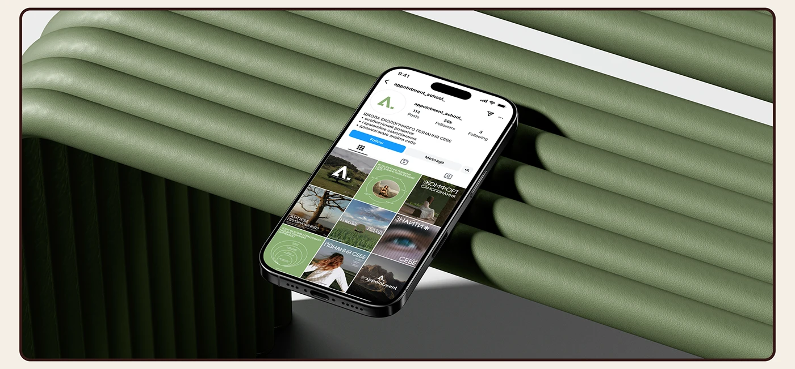

# Nature-therapy school Instagram profile on a phone leaning against giant green leather tubes

**Discipline:** print-social ·  · **Design style:** 3D & Surreal
**Tags:** instagram, feed-grid, mockup, green, leather, fluted, cream-frame, 3d-scene

## What it is
A phone displaying a profile with a green logo and a 3x3 grid of muted nature photos and green posts leans against a big sculptural stack of olive-green leather tubes on a dark base, in a brown-outlined cream frame.

## What it means
Calm and tactile; the green tubes echo the brand's palette.

## Techniques
- Match the scene material to the brand colour.
- Use fluted forms as a stage.
- Frame with a brown keyline.
- Show the full feed grid.

## Best for
- Social feed presentations
- Wellness and education brands
- Green palette mockups

## Vocabulary
- **Fluted leather** — Tubular leather-covered forms.
- **Material match** — A setting that echoes the brand colour.
- **Sculptural stage** — A 3D form used as a display.
- **Feed grid** — A 3x3 image of profile posts.
