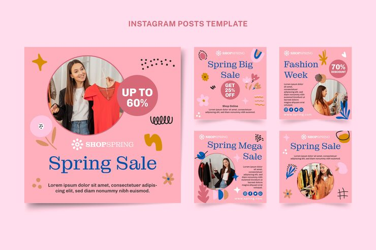

# ShopSpring sale pack on pink with Matisse-style cut-out shapes and royal-blue serif

**Discipline:** print-social · **Design type:** Social template pack · **Design style:** Playful & Illustrated
**Tags:** spring, sale, pink, blue, cutout-shapes, fashion

## What it is
Five pink square posts with circle photos of a woman shopping for clothes, royal-blue serif headlines ('Spring Sale', 'Fashion Week'), mauve discount circles ('Up to 60%'), and scattered hand-cut shapes: flowers, leaves, squiggles, sparkles, dots and a hashtag sign.

## What it means
Joyful and fresh; paper-cut shapes feel handmade and springlike.

## Techniques
- Scatter Matisse-like cut-out shapes around the frame.
- Pair a single blue serif with a pink field.
- Use a circle photo with a smaller offer circle overlapping it.

## Best for
- Seasonal fashion sales
- Boutiques
- Spring campaigns

## Vocabulary
- **Cut-out shapes** — Simple flat forms that look cut from paper.
- **Overlapping circles** — Circles layered to link photo and offer.
