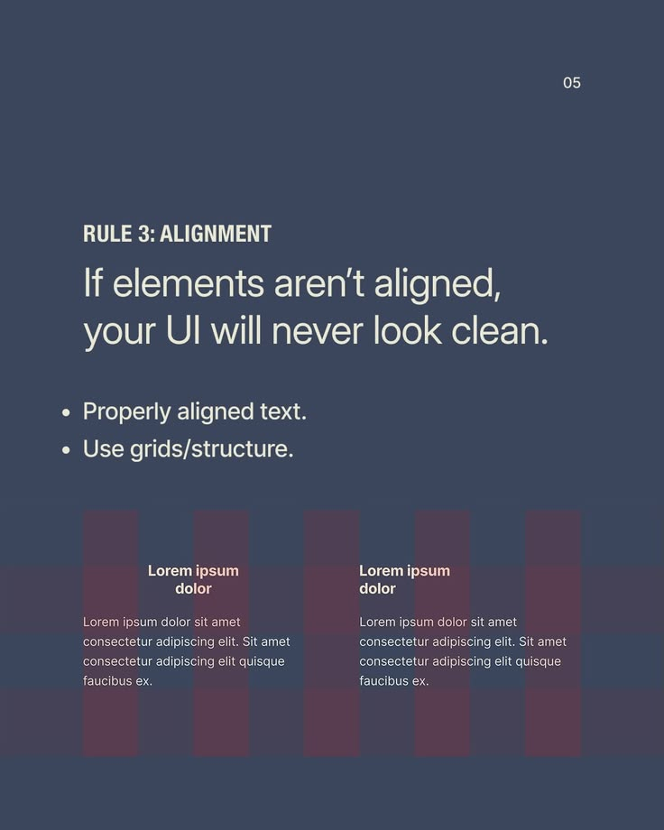

# Alignment Rule with Column Overlay

**Discipline:** print-social ·  · **Design style:** Geometric & Bauhaus
**Tags:** educational, alignment, slate, columns, grid, rules, typography

## What it is
A slate-blue slide, 'Rule 3: Alignment', with condensed heading, large statement, two bullets and a demo of two text blocks over translucent maroon column bars.

## What it means
The demo shows the lesson visually. Muted slate and cream feel serious and scholarly.

## Techniques
- Semi-transparent column overlay to reveal the grid
- Condensed uppercase label above a light large sentence
- Sample text blocks aligned to the columns
- Muted two-colour palette
- Small page number top right

## Best for
- Design-principle carousels
- Layout and grid education
- Slide-style social posts

## Vocabulary
- **Column overlay** — Translucent bars showing layout columns.
- **Alignment** — Positioning elements along shared edges or axes.
- **Rule slide** — A slide presenting one numbered design principle.
