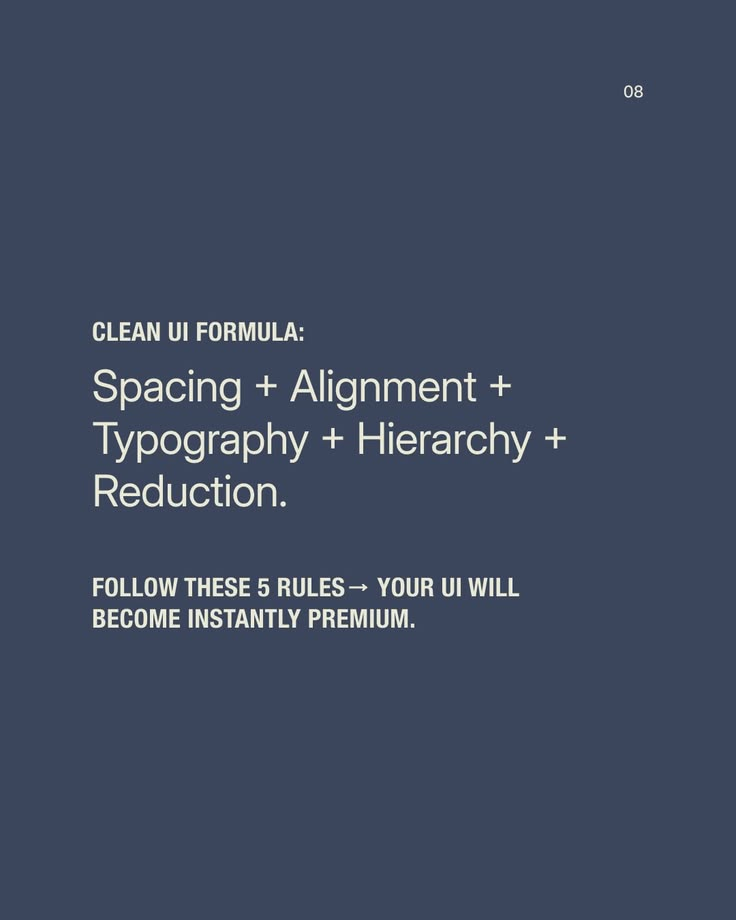

# Clean UI Formula Summary Slide

**Discipline:** print-social ·  · **Design style:** Minimalist
**Tags:** educational, summary, slate, cream, text-only, formula, condensed

## What it is
A slate-blue text-only slide with a condensed 'CLEAN UI FORMULA' label, a light sum 'Spacing + Alignment + Typography + Hierarchy + Reduction.' and a bold line saying five rules make a UI premium.

## What it means
A formula as a sentence sums up the series memorably, with only type and colour.

## Techniques
- Plus signs turning a list into a formula
- Condensed caps label above a light statement
- Bold closing promise
- Small page number top right
- Two-colour palette

## Best for
- Series summary slides
- Design principle recaps
- Type-only carousels

## Vocabulary
- **Formula line** — A sentence built with plus signs to summarise a method.
- **Recap slide** — A slide restating the series in one line.
- **Type-only slide** — A slide made only of text.
