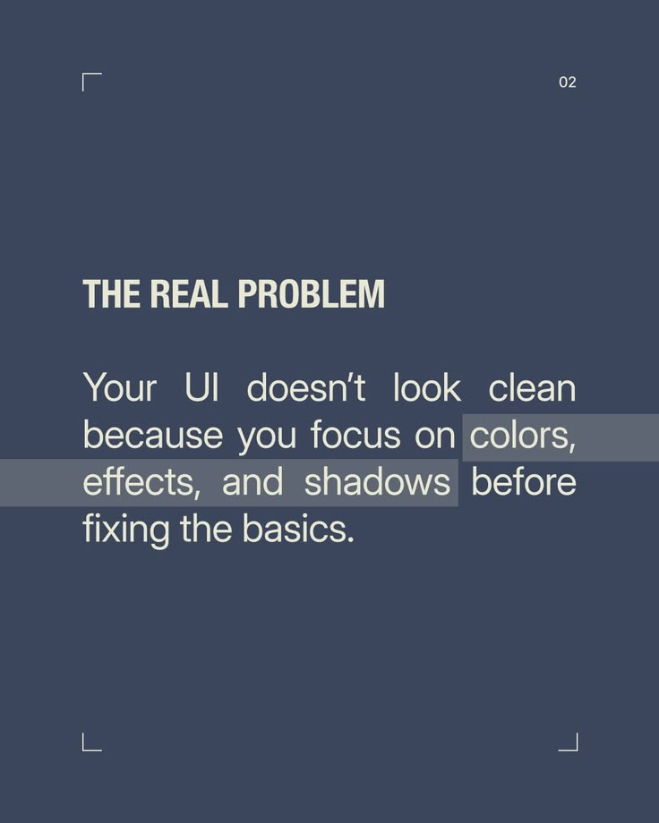

# The Real Problem Highlighted Text Slide

**Discipline:** print-social ·  · **Design style:** Minimalist
**Tags:** educational, problem, slate, highlight, corner-marks, justified, text-only

## What it is
A slate-blue slide with corner crop marks, a condensed caps title 'THE REAL PROBLEM' and a justified paragraph in which key phrases sit on translucent grey highlight bars.

## What it means
Highlight bars act like a marker pen, pointing out the key phrases, and corner marks give a designed frame.

## Techniques
- Translucent highlight bars behind words
- Corner crop marks framing the slide
- Justified paragraph for an editorial look
- Condensed caps title
- Only two colours

## Best for
- Problem statement slides
- Text-led carousels
- Highlighting key phrases

## Vocabulary
- **Highlight bar** — A translucent rectangle behind selected words.
- **Crop marks** — Corner marks that frame a slide like a print sheet.
- **Justified text** — Text aligned to both left and right edges.
