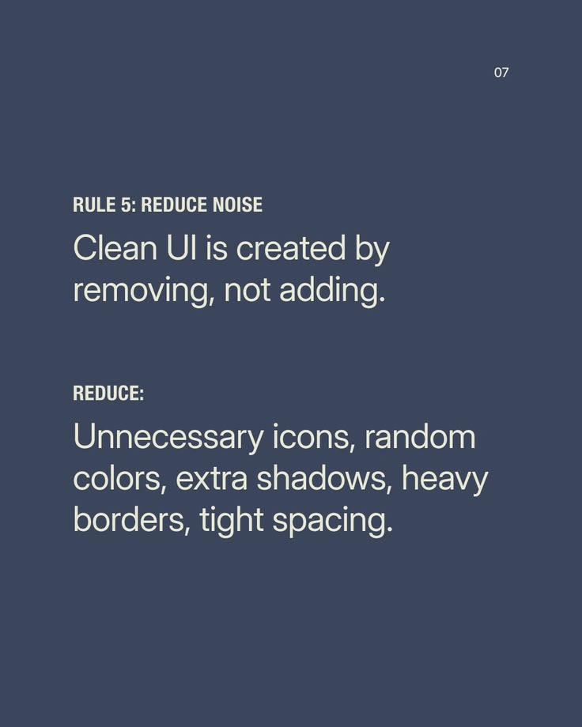

# Reduce Noise Rule Post

**Discipline:** print-social · **Design type:** Social educational post
**Tags:** educational, rule, slate, cream, text-only, minimal, condensed

## What it is
A slate-blue text-only slide, Rule 5 Reduce Noise, with a condensed uppercase label, a large light statement and a list of what to reduce, in cream.

## What it means
The slide practises what it says: it is nearly empty, using type alone.

## Techniques
- Only type and two colours, no graphics
- Condensed caps label above light sentence
- Generous negative space
- Small page number top right
- Series consistency with the other rule slides

## Best for
- Design principle carousels
- Minimal educational posts
- Series slides

## Vocabulary
- **Type-only slide** — A slide with no imagery, relying on typography.
- **Negative space** — Empty space that gives content room.
- **Rule series** — Numbered slides each stating one principle.
