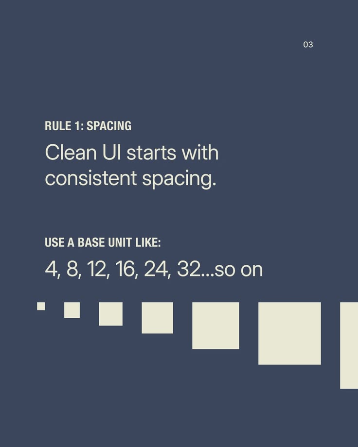

# Spacing Base Unit Scale Post

**Discipline:** print-social ·  · **Design style:** Warm & Organic
**Tags:** educational, spacing, slate, cream, squares, scale, rule-1

## What it is
A slate-blue slide, Rule 1 Spacing, with a light sentence 'Clean UI starts with consistent spacing', a list of base units 4, 8, 12, 16, 24, 32 and a row of cream squares growing in size across the bottom edge.

## What it means
Squares that grow by the same steps as the numbers make the scale visible, and the layout is nearly all type and one graphic.

## Techniques
- Squares sized to match the numbers listed
- Condensed caps label above a light line
- Row of squares bleeding off the right edge
- Two-colour palette
- Small page number top right

## Best for
- Design-principle carousels
- Spacing and scale lessons
- Minimal educational slides

## Vocabulary
- **Base unit** — A small value that all spacing is a multiple of.
- **Spacing scale** — A set of allowed spacing values such as 4, 8, 16.
- **Bleed graphic** — A shape running off the edge of the canvas.
