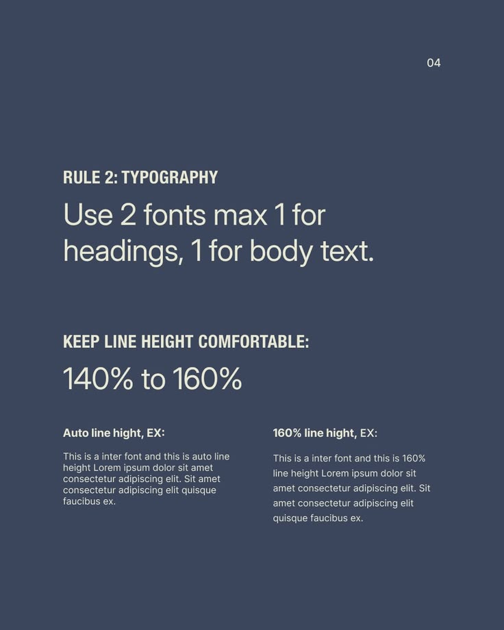

# Two Fonts and Line Height Rule Post

**Discipline:** print-social ·  · **Design style:** Warm & Organic
**Tags:** educational, typography, slate, cream, line-height, comparison, rule-2

## What it is
A slate-blue slide, Rule 2 Typography, saying to use two fonts maximum, one for headings and one for body, and to keep line height between 140% and 160%, with two small text samples comparing auto and 160% line height.

## What it means
Showing the same paragraph at two line heights lets viewers see the difference, and a two-colour layout keeps it clear.

## Techniques
- Side-by-side comparison of two settings
- Condensed caps sub-labels above light statements
- Large numeric range as a key figure
- Small sample paragraphs in two columns
- Cream on slate two-colour palette

## Best for
- Typography education carousels
- Design rule series
- Comparison posts

## Vocabulary
- **Line height** — The vertical distance between lines of text.
- **Type pairing limit** — A rule of using only two typefaces in a design.
- **Side-by-side sample** — Two versions of the same content shown together.
