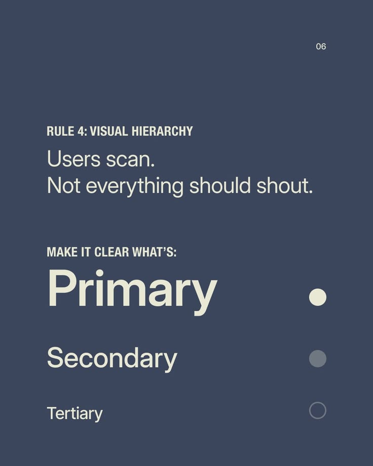

# Visual Hierarchy Primary Secondary Tertiary

**Discipline:** print-social ·  · **Design style:** Minimalist
**Tags:** educational, hierarchy, slate, type-scale, dots, minimal

## What it is
A slate-blue slide, Rule 4 Visual Hierarchy, with a light heading and three words, Primary, Secondary and Tertiary, each smaller and paired with a solid, half-tone and outlined dot.

## What it means
The slide is its own demonstration: the layout itself shows what hierarchy looks like through size and fill.

## Techniques
- Demonstrate the concept in the layout itself
- Three sizes stepping down for three importance levels
- Filled, half, empty dots as an importance scale
- Condensed caps label above a light sentence
- Two-colour palette of slate and cream

## Best for
- Design-principle carousels
- Teaching typography and hierarchy
- Minimal slide-style posts

## Vocabulary
- **Visual hierarchy** — Ordering elements by importance using size, weight and contrast.
- **Self-demonstrating layout** — A design that illustrates its own message.
- **Importance dots** — Marks whose fill level signals priority.
