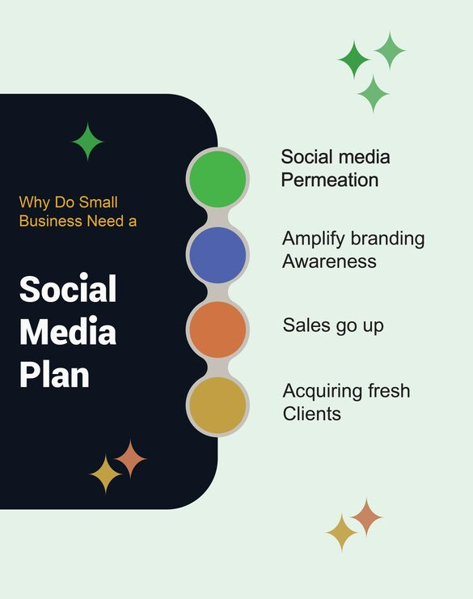

# Dark rounded panel slide with circular chain bullet list

**Discipline:** print-social · **Design type:** Presentation slides · **Design style:** Minimalist
**Tags:** presentation, slide, bullet list, dark panel, circle chain, minimal

## What it is
A slide pairing a dark rounded corner panel with a bold headline on the left against four colored circles connected in a vertical chain, each linked to a short benefit line on the right.

## What it means
Threading colored circles into a connected vertical chain visually implies a sequence or a build-up of reasons, making a plain bullet list feel structured and directional.

## Techniques
- connect a bulleted list's markers into a visible vertical chain to imply sequence/cause-effect
- use one accent color per bullet marker while keeping body text neutral
- offset a rounded dark content panel to one side rather than centering it

## Best for
- business case/strategy presentation slides
- 'why choose us' marketing pages
- minimal pitch deck templates

## Vocabulary
- **content hierarchy** — the visual ordering of elements (size, color, position) that guides a viewer's reading order
