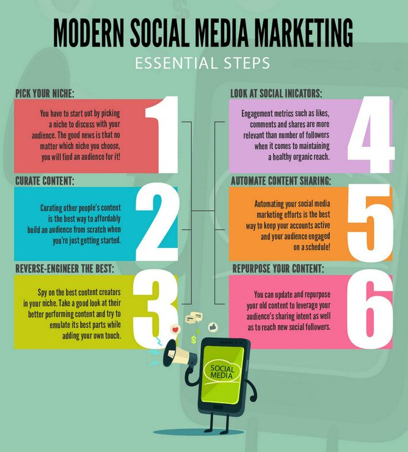

# 'Modern Social Media Marketing' six-step infographic in colour-block cards with a phone character megaphone

**Discipline:** print-social · **Design type:** Product infographic set · **Design style:** Playful & Illustrated
**Tags:** infographic, marketing, mint, colour-blocks, numbered-steps, character

## What it is
A mint-green infographic with 'MODERN SOCIAL MEDIA MARKETING — Essential Steps' as the title, six colour-coded cards (pink, teal, yellow, purple, orange, magenta) each with a giant numeral (1-6), a bold label and short explanatory paragraph, connected in two branching columns, closing with a cartoon smartphone character shouting into a megaphone.

## What it means
Friendly and instructional; a cartoon character delivering the steps makes a marketing checklist feel approachable rather than dry.

## Techniques
- Colour-code each step card differently for quick visual reference.
- Branch steps into two parallel columns instead of one long list.
- Close with a mascot character to add personality.

## Best for
- Marketing education content
- Step-by-step infographics
- Colourful instructional design

## Vocabulary
- **Step card** — A card presenting one stage in a numbered process.
- **Mascot character** — An illustrated figure representing a brand or topic.
