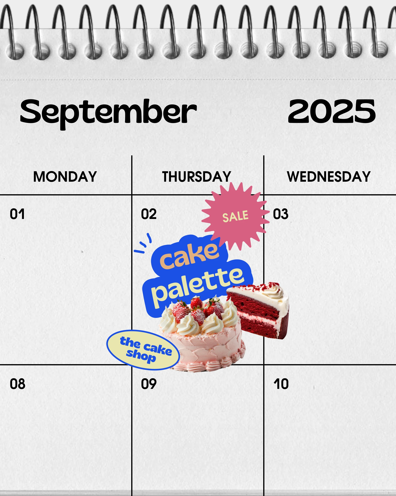

# Bakery promo stuck on a spiral wall calendar

**Discipline:** print-social ·  · **Design style:** Playful & Illustrated
**Tags:** calendar, bakery, sale-sticker, bubble-type, cutout, blue-and-cream, grid, social-media

## What it is
A 4:5 post showing a close-up of a spiral-bound wall calendar page with heavy black rules. A cut-out cake and slice sit on one day cell with a blue blob logo 'cake palette', a coral starburst SALE sticker and a cream oval 'the cake shop' label.

## What it means
Cute, dated and easy to grasp: the calendar says 'mark this day', and the stickers make the promo feel hand-placed and playful.

## Techniques
- Use a familiar object (calendar page) as the layout so a date-based message reads instantly.
- Drop cut-out product photos and sticker labels onto one cell to make the focal point.
- Keep the base neutral grey-white so a small cluster of blue, coral and cream pops.
- Use a starburst badge for sale info, echoing retail signage.
- Set the month and year in chunky rounded type to match the sticker voice.

## Best for
- Sales and event countdowns
- Food, bakery and café accounts
- Content calendars and announcement posts

## Vocabulary
- **Starburst badge** — A spiky circular shape used to flag offers.
- **Object-as-layout** — Using a real-world item (calendar, receipt, folder) as the frame of a design.
- **Sticker cluster** — A tight group of overlapping stickers forming the focal point.
- **Blob label** — A rounded organic shape behind text.
