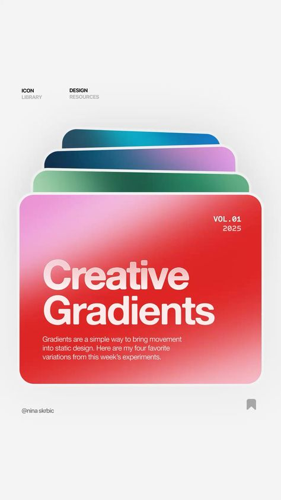

# Fanned stack of four gradient cards with a glossy red 'Creative Gradients' front card

**Discipline:** print-social · **Design type:** Social educational post
**Tags:** gradients, stack, red, pink, teal, green, glassy, monospace, resource-post

## What it is
A pale grey vertical post with tiny caps labels at the top, a fan of four rounded cards in teal, blue-violet, green and a large red-to-pink front card with a big white 'Creative Gradients' title, monospace 'VOL.01 2025' and short body, plus a handle and bookmark icon.

## What it means
Fresh and tactile; the fan makes gradients feel like collectable cards.

## Techniques
- Fan cards behind a hero card to show variety.
- Blur the gradient on the front card for depth.
- Set a heavy white title with light body text.
- Pair with monospace metadata.

## Best for
- Design-resource and tip posts
- Colour and style showcases
- Minimal light-background posts

## Vocabulary
- **Card fan** — Layered cards offset to show edges.
- **Mesh gradient** — A blurred multi-colour blend.
- **Volume tag** — A monospace label numbering a series.
- **Save icon** — A bookmark prompting saving.
